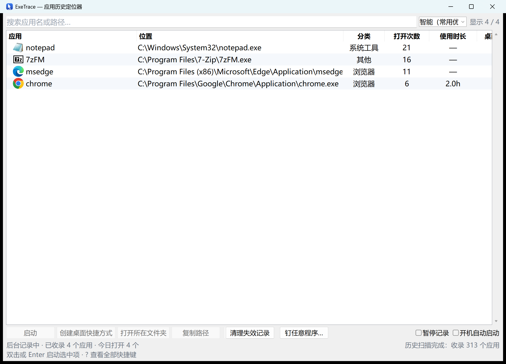

# ExeTrace v3 — 应用历史 + 一键钉到桌面

<p align="center">
  
</p>

**[⬇ 下载最新版](https://github.com/joker1point/ExeTrace/releases/latest)**（Windows 单文件 exe，双击即用，无需安装）

**▶ [功能演示：6 张真机操作动图（搜索 / 右键菜单 / 一键钉桌面 / 启动 / 托盘热键 / 帮助）](exetrace-native/docs/feature-demo.md)**

> 越来越多人能用 AI 快速做出一个小众、个性化的桌面软件，但作者往往没有编程背景：
> 不做桌面快捷方式，也不引导用户创建。用户用完、关掉界面，就再也找不到刚才那个软件在哪了。
> **ExeTrace 就是为了解决这件事**：后台记录你打开过的每一个应用，随时一键找回。

<p align="center">
  <br>
  <sub>界面截图（列表为示例记录）：选中历史里的任意一项即可一键钉到桌面；不在历史里的程序用底部「钉任意程序…」直接选 exe 或软件文件夹。</sub>
</p>

## 功能

| 能力 | 说明 |
|---|---|
| 实时记录 | 后台每 2 秒扫描新进程；凭「出现可见窗口 / 由 explorer 启动」确认真实打开，后台服务与更新器不会被误记 |
| 历史回填 | 首次启动即扫描注册表使用痕迹（FeatureUsage / MuiCache），不必等下一次打开 |
| 快速定位 | 搜索、按最近/次数/名称排序、双击直接启动、打开所在文件夹、复制路径 |
| **近 N 天过滤**（原生版） | 顶部「近 N 天」输入框：默认只加载最近 30 天打开过的记录（0 = 全部）——数据不删除，改大随时看全部，也让冷启动与列表渲染更快 |
| **一键钉到桌面**（v3） | 选中历史记录 → 直接创建桌面快捷方式；自带「起始位置」与图标，同名自动编号（**绝不覆盖**已有文件），创建后立即读回校验；「桌面」列显示已钉标记 |
| **任意程序一键钉**（v3.1） | 不限于历史记录：点「钉任意程序…」输入 / 选择**任意 exe 或软件文件夹** → 自动识别主程序（同名 exe 优先 → 跳过 setup/unins/helper 噪音 → 浅层优先），多候选可下拉切换。（能力并入自同源项目 DeskPin） |
| 图标与失效标记 | 显示应用图标；已删除的软件灰显「文件已丢失」，可一键清理 |
| 常驻托盘 | 关闭窗口后继续记录；开机自启是可选开关（默认关闭） |
| **运行中自动隐藏**（原生版，2026-10） | 「找回」只服务"还没找到"的：正在运行的应用自动从列表（含搜索）隐藏，关掉 ≤3 秒自动恢复；状态栏标出已隐藏数量 |
| **本机项目管理**（原生版，2026-10） | 自动扫描本机 git 仓库收进同一列表：顶部「视图」切 全部 / 应用 / 项目，按「自有 / 克隆 / 本地」分档；项目行支持 双击开文件夹 / 钉桌面（文件夹快捷方式）/ 打开 GitHub 页 / 一键更新（`git pull --ff-only`）；扫描根目录可在 `config.json` 配 `project_roots`，`--export` 导出 JSON |

## 使用

1. 双击 `ExeTrace.exe`
2. 在列表里找到目标应用 → 双击启动，或右键「打开所在文件夹」
3. **找不到它的安装位置？选中它 → 点「创建桌面快捷方式」**（或右键同项），下次直接从桌面进
4. **没在历史里的程序**（从没运行过 / 刚下载）：点底部「**钉任意程序…**」→ 选择 exe 或软件文件夹 → 创建（文件夹自动识别主程序，多候选可下拉切换）
5. **本机项目**（原生版）：顶部「视图」切「项目」——自动扫描的本机 git 仓库（自有 / 克隆 / 本地）都在这里；右键可「打开 GitHub 页」/「更新（git pull）」
6. 关闭窗口 = 缩到托盘继续记录；右键托盘图标 → 退出

命令行（脚本/批量）：

```powershell
.\ExeTrace.exe --make-shortcut "C:\path\to\App.exe" --name "我的工具"   # 成功退出码 0，已读回校验
.\ExeTrace.exe --make-shortcut "C:\path\to\AppFolder"                 # 文件夹也行：自动识别主程序
.\ExeTrace.exe --export [输出路径]                                     # 全量 JSON：apps + projects（schema: exetrace.export v2）
.\ExeTrace.exe --find <关键词>                                         # 查找应用/项目（stdout JSON；0=有结果 1=无结果）
.\ExeTrace.exe --launch "<路径>"                                       # 打开应用 / 文件夹
.\ExeTrace.exe --agent-guide                                          # 生成「交给 Agent」的接口说明
```

数据与日志（与 exe 存放位置无关，移动 exe 不丢历史）：

```
%LOCALAPPDATA%\ExeTrace\history.db     历史库
%LOCALAPPDATA%\ExeTrace\exetrace.log   运行日志
%LOCALAPPDATA%\ExeTrace\selftest.txt   最近一次自检报告
%LOCALAPPDATA%\ExeTrace\export.json    --export 的默认导出位置（JSON）
%LOCALAPPDATA%\ExeTrace\agent-guide.md --agent-guide 生成的接口说明
```

## 把 ExeTrace 交给你的 Agent

ExeTrace 把「数据」和「能力」都开了一个机器可读的口子，任意 AI Agent 都能直接用：

1. 生成一份**随本机路径**的接口说明（含调用契约与注意事项）：

   ```powershell
   .\ExeTrace.exe --agent-guide
   ```

2. 把生成的 `agent-guide.md`（默认在 `%LOCALAPPDATA%\ExeTrace\`）**整段发给你的 Agent**，
   再附一句你想做的事——例如「找出我上周用过的截图工具并打开它」；
3. Agent 即按契约读数据、调能力：

| 面 | 命令 | 输出 |
|---|---|---|
| 读 | `--export [路径]` | 全量 JSON：`apps[]` + `projects[]`（schema `exetrace.export` v2） |
| 读 | `--find <关键词>` | stdout JSON `count/apps[]/projects[]`；退出码 0=有结果 / 1=无结果 |
| 做 | `--launch <路径>` | 打开应用或文件夹（0=已启动） |
| 做 | `--make-shortcut <路径> [--name N]` | 钉到桌面（0=已创建且读回校验） |

> ⚠️ 本程序是 GUI 子系统 exe：PowerShell 里 `& exe ...` **不会等它跑完**（命令立刻返回、文件还没生成）。
> 请用 `cmd /c` 或 `Start-Process -Wait` 调用，并**以产物文件为准**（stdout 摘要可能晚到）。

## 两个实现

| 版本 | 位置 | exe 体积 | 特点 |
|---|---|---|---|
| **Python / tkinter（release 版）** | 根目录 | 20.4 MB | 功能最全（搜索排序 / 图标 / 托盘 / 一键钉桌面 / 分类 / 使用时长）；常态 CPU ≈ 2%（单核），**后台/最小化内存 5-8 MB** |
| **Rust / Win32 原生（新，推荐自构建）** | `exetrace-native/` | **1.61 MB** | 系统原生控件、不含任何 UI 框架：**托盘常驻约 2 MB**、窗口打开约 58 MB；功能对齐 v3.1。**[功能演示（6 张真机动图）](exetrace-native/docs/feature-demo.md)** |
| Rust / egui（实验） | `exetrace-rs/` | 6.8 MB | 冷启动快、体积小；内存偏高（约 120 MB，为 egui 框架基线） |

两个版本共用同一 SQLite 库（`%LOCALAPPDATA%\ExeTrace\history.db`，schema 一致），数据互通；不建议同时常驻（会双重记录）。

## 从源码构建

```powershell
.\build.ps1        # 干净 venv + PyInstaller onefile → dist\ExeTrace.exe
```

开发运行与自检：

```powershell
.\.venv-build\Scripts\python.exe src\main.py --no-tray
.\.venv-build\Scripts\python.exe src\main.py --selftest
```

## 验证

`--selftest` 覆盖：路径模型 / SQLite 读写与去重 / 注册表扫描 / 图标提取 / 噪音过滤 / 窗口枚举。
打包后运行 `dist\ExeTrace.exe --selftest` 验证交付形态（windowed 产物无控制台，结果落盘
`%LOCALAPPDATA%\ExeTrace\selftest.txt` 回读）。

## 已知边界

- 只能记录 ExeTrace 运行期间打开的应用；更早的历史依赖注册表痕迹（无时间戳条目标为 "—"）
- 以管理员权限运行的程序可能因权限读不到 exe 路径而漏记
- 同一次启动派生多个进程（如 Chromium 系）按 5 分钟窗口去重，只计一次
- onefile 打包是双进程模型：任务管理器里看到两个 `ExeTrace.exe` 属正常现象
- 已开始常驻后，任务栏图标消失不等于退出：右键托盘图标 → 退出
- 正在运行的应用不显示在列表里（含搜索）——想给它钉桌面，先退出它再找

## 验收（可复跑）

```powershell
.\.venv-build\Scripts\python.exe src\main.py --selftest      # 源码形态
.\dist\ExeTrace.exe --selftest                                # 交付形态（结果落盘 selftest.txt）
.\.venv-build\Scripts\python.exe tools\e2e_check.py           # 端到端：GUI+实时记录+数据目录
```
