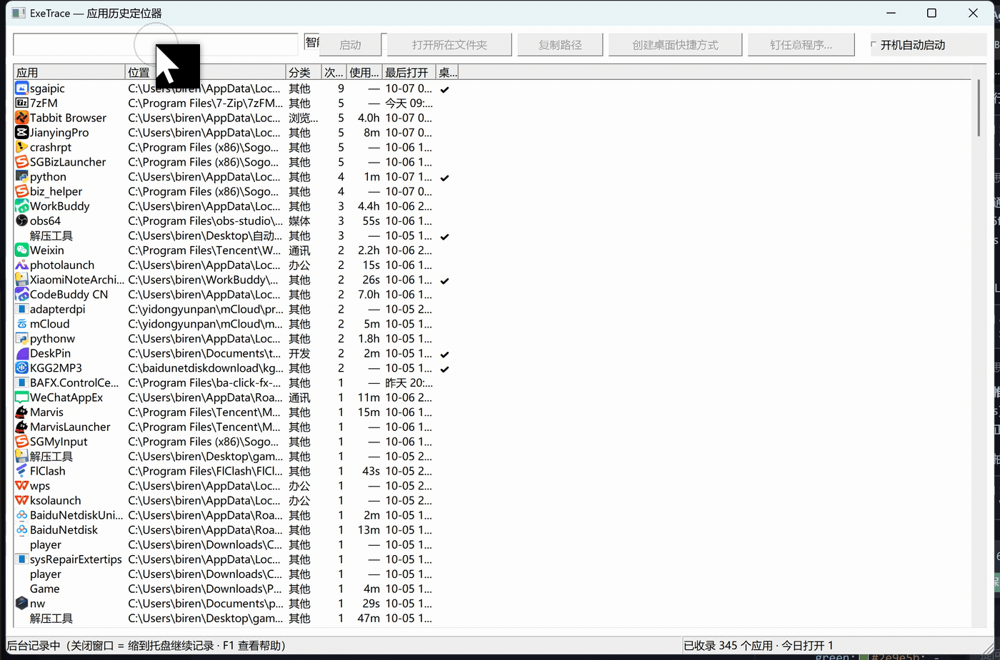
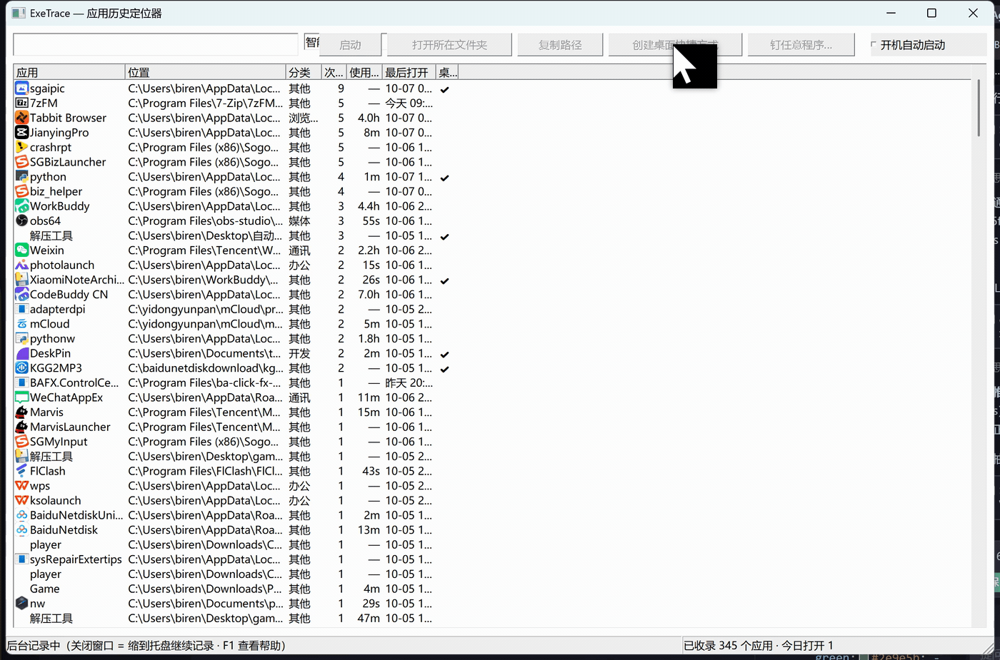
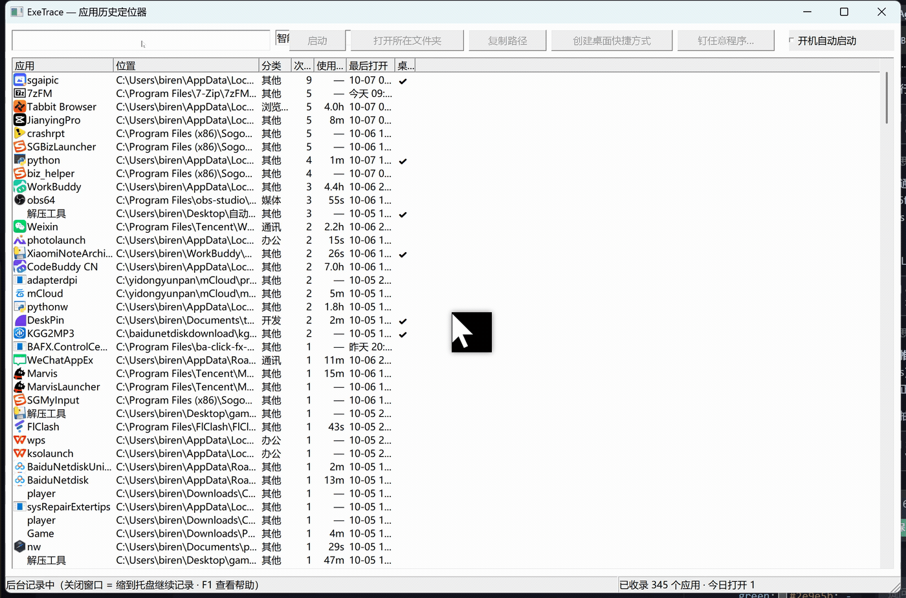
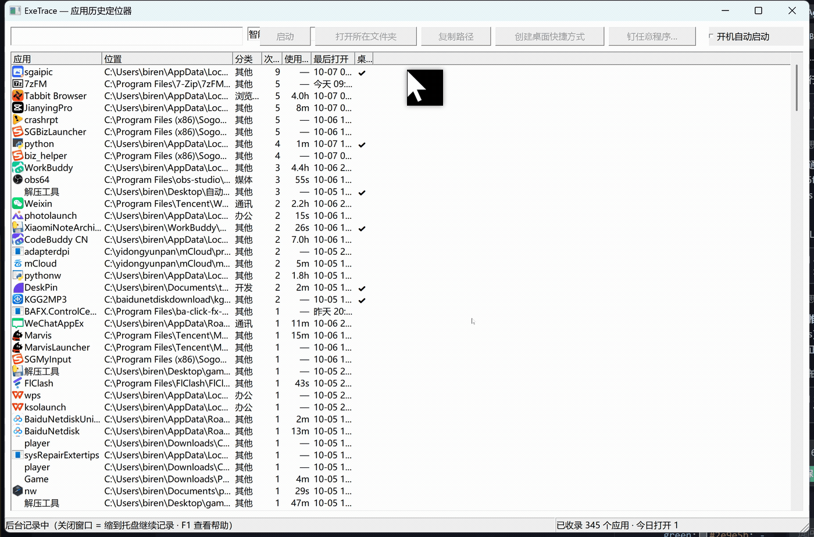
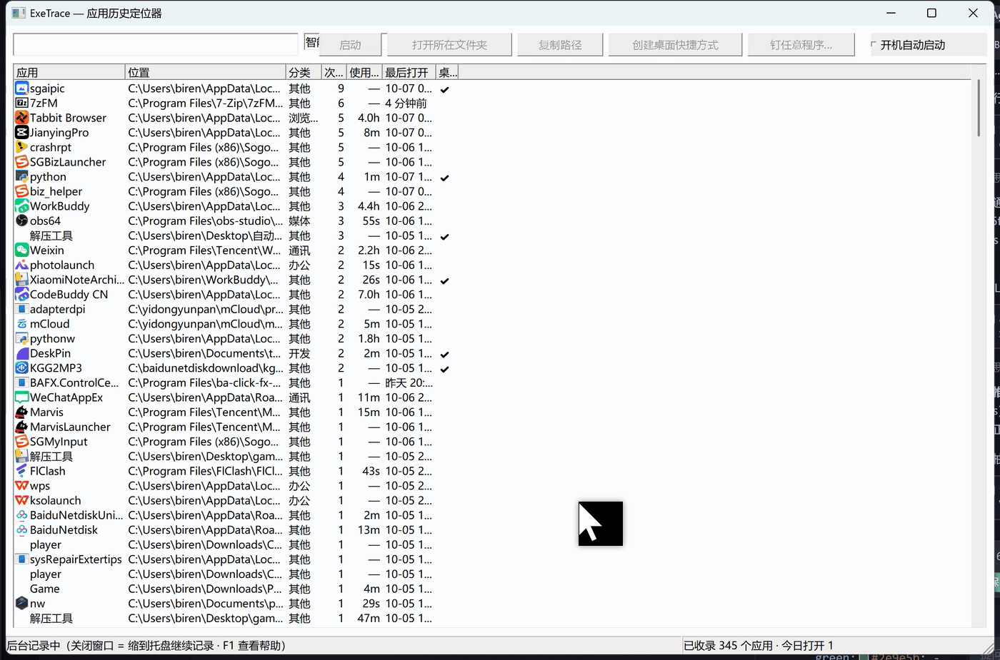
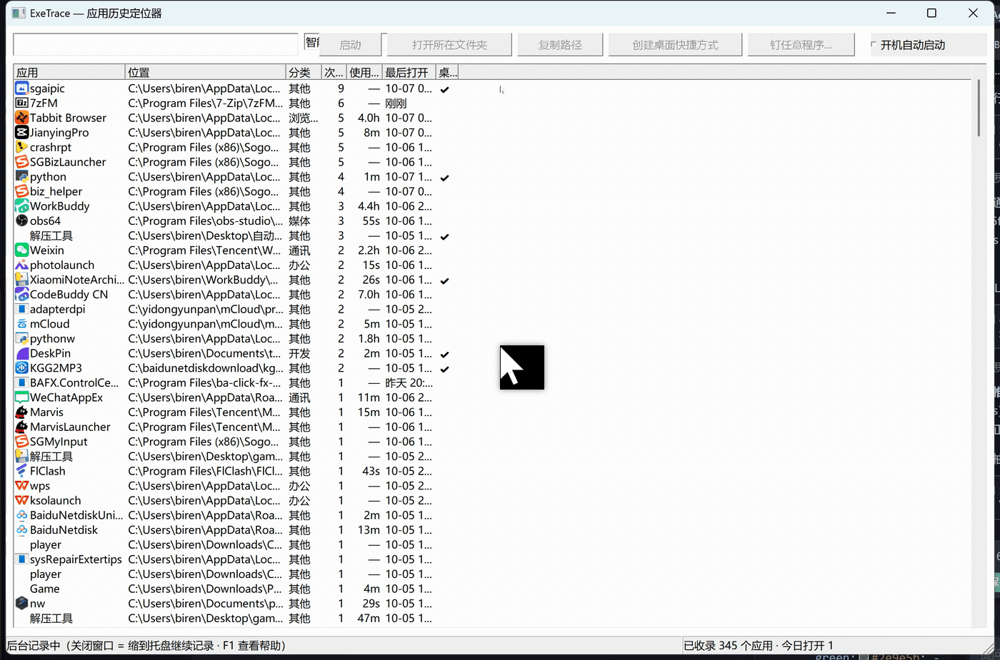
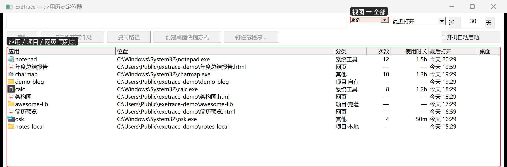
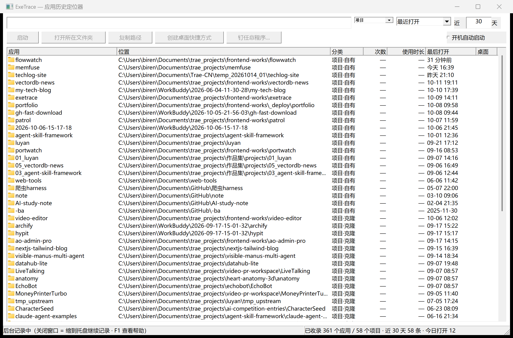
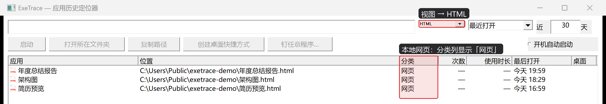

# ExeTrace 功能演示

> 本文档中的每一张动图都是**真实操作录制**（真实鼠标、真实点击、真实反馈），
> 不是效果图或摆拍。录制脚本见 `tools/demo_record.py`（可复现，任何人都能重录）。
>
> **图的时效与对应关系**：6 张动图录于 2026-10-09（v1.1.0 时期），展示的是**操作方式**；
> 之后新增的菜单项、「视图」第四项（HTML）、更密的默认排序，以文字与第 7 节的**静态截图**为准。
> 红框只出现在第 7 节的截图上，**框住的就是那张图要说明的功能**；动图里靠放大的鼠标指针 + 点击脉冲圈指认操作位置。

---

## 它解决什么问题

你有没有过这种时刻：

- 上周用一个小工具处理了张图片，现在想再用一次，**名字记不起来了**；
- 从开始菜单里翻了三层，才找到一个其实天天用的程序；
- 装完某软件，桌面多了一堆图标，**其实你只想要一个**。

ExeTrace 做三件事：**记住你打开过的一切** · **一秒找回来** · **一键钉到桌面**。

它常驻系统托盘（约 8 MB 内存），默默记录你启动过的每个应用——不论你是从桌面快捷方式、
开始菜单还是命令行打开的。关掉界面它仍在后台工作；需要时按 `Ctrl+Alt+E` 随时呼出。

---

## 1. 搜索：从几百个应用里一秒找到



**在做什么**：在搜索框输入 `chrome`，列表实时过滤出所有相关应用，按 `Esc` 一键复原。

- 输入即筛，不需要回车、不需要等
- 匹配范围包含**应用名**和**完整路径**——想不起来名字时，输入项目目录名也能找到
- 小贴士：`Ctrl+F` 可以在任何位置直接跳到搜索框（并全选，输入即替换）

---

## 2. 双击启动：找回来，就顺手打开



**在做什么**：搜索定位到 7-Zip，**双击**列表项，程序被真实启动。

- 双击 = 启动；单击 = 选中（可再配合底部按钮做其它操作）
- 列表默认按**最近打开**排序；顶部下拉可切换：最近打开 / 智能排序 / 打开次数 / 名称
- 「智能排序」= frecency（`打开次数 × e^(-距今天数/30)`，30 天半衰期）：经常用 + 最近用的自动浮到前面

---

## 3. 右键菜单：启动、定位、复制、钉桌面，一个都不少



**在做什么**：右键任意一行，用方向键选中「复制完整路径」，状态栏立刻给出反馈。

右键菜单包含：

| 菜单项 | 作用 |
|---|---|
| 启动 | 打开这个应用 |
| 打开所在文件夹 | 在资源管理器中定位到该 exe |
| 复制完整路径 | 复制 exe 的完整路径到剪贴板 |
| 创建桌面快捷方式 | 把这个应用钉到桌面（同名自动编号，绝不覆盖） |
| 加入 memfuse 白名单 | 加进 memfuse 的 `protect-list.txt`（内存紧张时它不会再被杀）；需要本机装了 [memfuse](https://github.com/joker1point/memfuse)，脚本位置自动探测，也可用 `config.json` 的 `memfuse_script` 指定 |
| 从历史中移除 | 从记录里删除这一条 |
| 清理失效记录 | 一次性清理掉所有已被卸载/移动的程序 |
| 暂停记录 | 临时停止记录（比如你在做隐私敏感的事） |
| 帮助 (F1) | 打开帮助面板（含完整快捷键表） |

选中**项目行**（见第 7 节）时，菜单会换成项目适用的项：**打开文件夹 / 打开 GitHub 页 / 更新（git pull）**；
「重新扫描项目」对所有行可用。

---

## 4. 一键钉到桌面：把「刚找回的程序」变成桌面图标



**在做什么**：选中一行 → 点「创建桌面快捷方式」→ 窗口右侧弹出**反馈卡片**，状态栏同步确认，列表的「桌面」列打勾。

- **成功的瞬间给强反馈**：卡片（✓ + 文件名 + 方位）弹出并停留约 3.4 秒，同时有一声系统提示音
- **会告诉你它落在桌面哪个区**（左上 / 上方 / 右上 / 左侧 / 中央 / 右侧 / 左下 / 下方 / 右下）——
  桌面图标多到一屏放不下时，不用逐个翻找
- 创建的快捷方式带**正确的图标、起始位置和名称**（不是那种打开就报错的裸链接）
- 创建后会**自动读回校验**——校验不通过会明确告诉你，不糊弄
- 同名文件存在时自动编号（`微信 (2).lnk`），**绝不覆盖你桌面上已有的东西**
- 想钉桌面上**还没被记录过**的程序？点「钉任意程序…」，选 exe 或**整个软件文件夹**——
  它会自动识别出该文件夹里的主程序（跳过 setup/uninstall/helper 这类杂物）

---

## 5. 托盘常驻 + 全局热键：不占地方，随时都在



**在做什么**：关闭窗口（它缩进了托盘）→ 在别的地方按 `Ctrl+Alt+E` → 窗口立刻回来且光标已在搜索框里。

- **关闭窗口 ≠ 退出**：关窗只是缩到托盘，记录继续
- **`Ctrl+Alt+E` 全局热键**：在任何程序里都能呼出，呼出即可直接输入搜索
- 真正退出：右键托盘图标 → 退出
- 托盘菜单还可以：暂停记录 / 开关开机自启
- 内存占用（实测）：常驻约 **8 MB**，窗口打开约 3–7 MB

---

## 6. 内置帮助：快捷键全在这里



**在做什么**：打开帮助面板（`F1`，或右键菜单 →「帮助 (F1)」）——功能说明、快捷键表、托盘说明、配置文件格式都在里面。

---

## 7. 一个列表装三类东西：应用 / 项目 / 网页

顶部「**视图**」下拉是这个列表的总开关：**全部 / 应用 / 项目 / HTML**。
下面三张图分别是切到「全部」「项目」「HTML」时的样子 —— **红框标出的就是该图要展示的那一项**。

### 7.1 全部：三类混排



**看哪里**：红框是「视图」下拉（停在「全部」）；同一屏里同时有**应用**（系统工具）、**项目**（项目·自有 / 克隆 / 本地）和**网页**（本地 html），靠「分类」列一眼区分。

- 搜索、排序、钉桌面对三类行**走同一套逻辑**
- 应用行按所选排序（默认最近打开）；项目行先按档位分组，档内再排

### 7.2 项目：本机 git 仓库也收进来



**看哪里**：视图切到「**项目**」；红框是「分类」列里的**档位**。

- **自动扫描**：默认扫 `文档 / WorkBuddy / 桌面` 下的 git 仓库（深度 ≤4；跳过 node_modules、target 等重目录）；启动时后台跑一次，也可右键「重新扫描项目」
- **分档**：remote 指向自己（joker1point / 自建服务器）→「自有」；其他远程 →「克隆」；没有 remote →「本地」
- **凭据纪律**：扫描**不保存** remote URL；「打开 GitHub 页」时才现读 `.git/config`，并**剥掉 URL 里的用户名/token**
- **项目行的操作**：双击 = 打开文件夹 · 右键「打开 GitHub 页」= 浏览器打开仓库 · 「更新（git pull）」= 快进式拉取（`--ff-only`，有本地改动不会硬来，失败弹详情）· 「创建桌面快捷方式」= 钉一个指向文件夹的快捷方式

### 7.3 HTML：浏览器打开过的本地网页（v1.2.0）



**看哪里**：视图切到「**HTML**」；列表只剩本地网页，红框是「分类」列里的「网页」。

- **数据源** = Windows 自带的「最近使用的项目」目录（`%APPDATA%\Microsoft\Windows\Recent` 里的 `.lnk`）—— **不劫持浏览器、不读浏览器私有库、不需要额外权限**
- 支持 `.html / .htm / .xhtml`；双击用默认浏览器再打开
- **目标文件已删除的不收录**（不留死链）；文件夹的快捷方式自动跳过
- 覆盖范围 = 最近打开过的那些（Windows 自己会滚动清理，不是无限历史）
- 「全部」视图里网页行与应用、项目混排；`--export` / `--find` 也带 `htmls[]`，Agent 能直接按 `source=html` 过滤

---

## 8. 做减法：正在运行的应用自动隐藏

> 本节暂不配图：出图需要真的启动一个会弹窗的程序，会打断正在用电脑的人，与采集纪律冲突 —— 宁可留文字。

「找回」工具只服务"还没找到"的东西——**已经在运行的应用不出现在列表里**：

- 开着一个应用时，在列表（含搜索结果）里看不到它；关掉后 ≤3 秒自动出现
- 判定 = 进程正在运行（按 exe 完整路径确认；读不出路径的提权进程按同名兜底）
- 状态栏会标出「已隐藏 N 个运行中」——不是凭空少了几行；窗口最小化 / 隐藏时不重建列表（保持原性能纪律），恢复显示后 ≤3 秒跟上

---

## 附：完整快捷键

| 按键 | 作用 |
|---|---|
| `回车` | 启动选中项（在搜索框里按也一样） |
| `双击` | 启动该应用（项目行 = 打开文件夹） |
| `Delete` | 从历史中移除选中项 |
| `Ctrl+C` | 复制选中项路径 |
| `Ctrl+F` | 聚焦搜索框（全选已有内容） |
| `Esc` | 清空搜索（焦点在搜索框时） |
| `F5` | 刷新列表 |
| `F1` | 打开帮助 |
| `Ctrl+Alt+E` | **全局**呼出主窗口（任何程序里都能用） |

---

## 附：配置文件

`%LOCALAPPDATA%\ExeTrace\config.json`（改完自动生效，无需重启）：

```json
{
  "ignore": ["spam-tool.exe"],
  "categories": { "code.exe": "开发" },
  "project_roots": ["D:\\dev"]
}
```

- `ignore`：不想被记录的程序（写文件名或路径片段）
- `categories`：覆盖列表里显示的「分类」列（按 exe 文件名指定）
- `project_roots`：项目扫描的根目录列表（不写 = 默认扫 `文档 / WorkBuddy / 桌面`）

---

## 复现这些动图

```powershell
# 录制（会独占鼠标键盘约 20 秒/场景，请勿同时操作电脑）
python tools/demo_record.py --list            # 查看全部场景
python tools/demo_record.py --scene 1-search  # 单个场景
python tools/demo_record.py --all             # 全部重录
```

产物：`assets/demo/*.gif`（动图）+ `assets/demo/raw/*.mp4`（中间录像，便于只调 GIF 参数：
`--gif-only`）。
